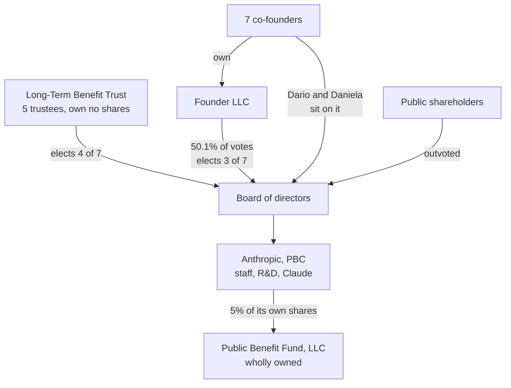
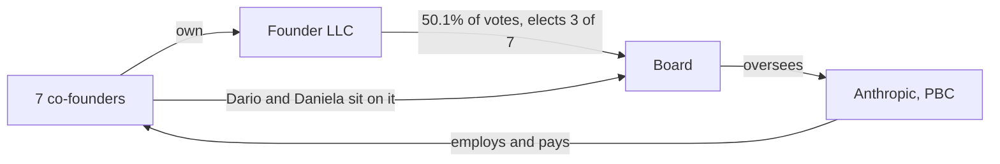

I saw a video breaking down Anthropic's corporate structure, got curious about how it actually fits together, and ended up drawing it out from the S-1 they filed on 26 October 2026.

## ELI5

Anthropic sold the public a claim on the profits and kept the votes. Five trustees who own no stock elect most of the board, and seven founders hold one special share that outvotes everyone else. I mean, you can buy the stock, but you don't get any say in how the company runs.

So Anthropic, PBC is the operating company, a Delaware public benefit corporation, which means its charter tells directors to balance a stated public benefit ("the responsible development and maintenance of advanced AI for the long-term benefit of humanity") against shareholder profit. Above that sit two things. The Long-Term Benefit Trust is five trustees who own no shares and elect four of the seven directors. The Founder LLC is owned by the seven co-founders, one vote each, and holds one share worth 50.1% of all shareholder votes, enough to elect the other three. Then there's the Public Benefit Fund, an LLC Anthropic owns outright that holds about 5% of the company's own shares. Two of the founders, Dario and Daniela Amodei, sit on the board as well.

And that's the loop. Any four of the seven founders can cast that 50.1% vote, electing the directors who oversee the company that employs and pays them. Yeah, the founders elect the people who run the place that pays them.

There's one way out. If fewer than three continuing founders remain for 90 days straight, a 450-day transition kicks in, after which the special shares are redeemed for nothing and the board changes.

## The Founder LLC is a messed up concept

One share, and that's the whole trick, really. The founders can sell off every economic interest they have, keep 50.1% of the votes, and there's nothing anyone who put money in can do about it. You buy in and get a vote that always loses, plus a claim on the profits. The five trustees who elect most of the board were picked by the trustees before them. Every check you'd expect in a normal company is either owned by the company itself or staffed by the same small group of people.

Maybe that's what building safe AI at this scale requires, I don't know. From the outside it looks like the easiest way anyone has found to raise a fortune and never answer to anyone for it. A handful of people get to decide what the technology turns into because they think it should look a certain way, and the market pays for that belief without getting any say in it. They might well be right. But if they're wrong, they still got paid, and the rest of us find out the hard way later.

It's pretty ridiculous, in my opinion, and the filing says so in legal language.

*Sources: Anthropic's [S-1](https://www.sec.gov/Archives/edgar/data/2130357/000162828026067168/anthropicpbc-sx1.htm) filed 26 October 2026, and Anthropic's [Long-Term Benefit Trust](https://www.anthropic.com/news/the-long-term-benefit-trust) announcement.*
